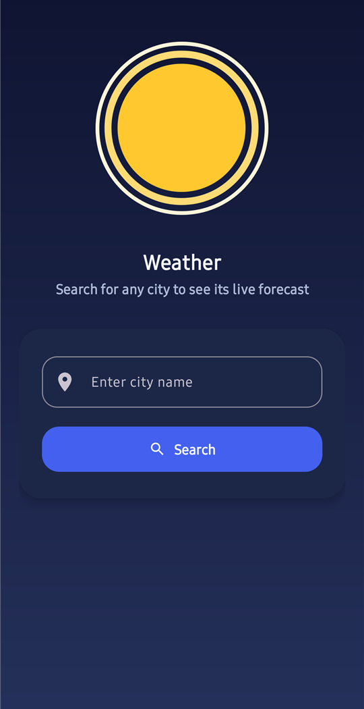
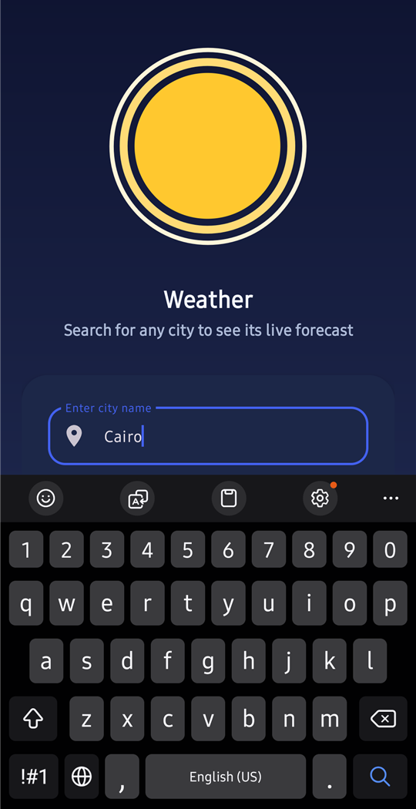
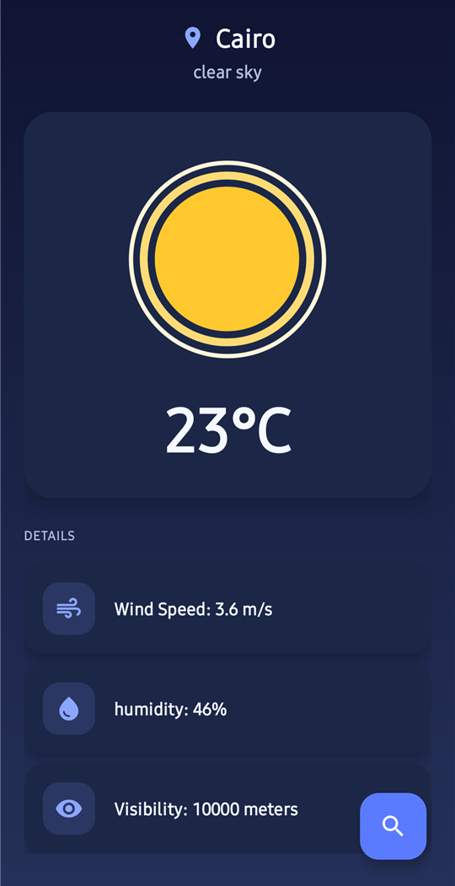
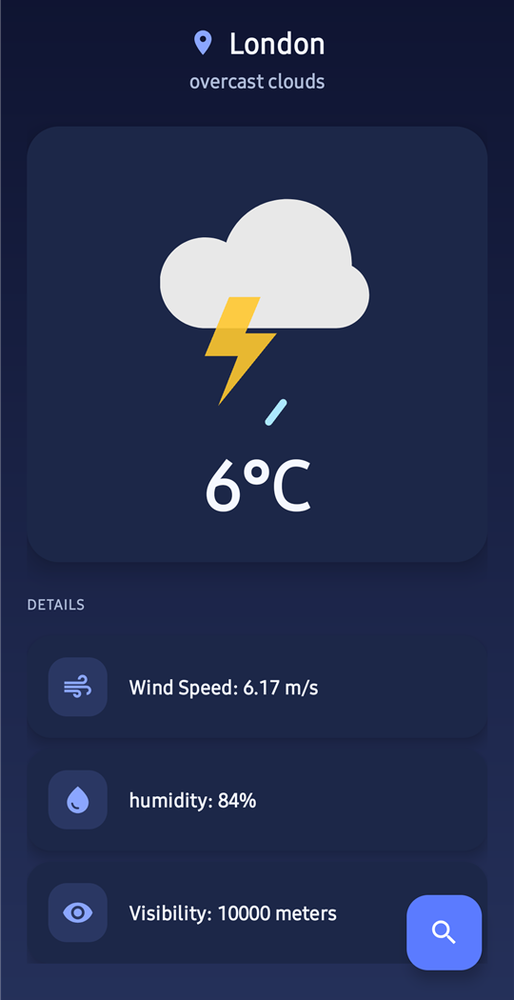

# WeatherApp

A simple Android weather app. Search for any city to see its current weather, pulled live from the [OpenWeatherMap](https://openweathermap.org/) API.

## Screenshots

<p align="center">
  
  &nbsp;
  
  &nbsp;
  
  &nbsp;
  
</p>

<p align="center">
  <sub>Search &nbsp;•&nbsp; Typing a city &nbsp;•&nbsp; Cairo, clear sky &nbsp;•&nbsp; London, overcast</sub>
</p>

## Features

- **City search:** enter any city name to get its current weather.
- **Live data:** temperature (°C), weather condition, wind speed, humidity and visibility.
- **Animated weather icons:** Lottie animations for sunny, rainy, snowy and stormy weather.
- **Remembers your last city:** the last searched city loads automatically when you reopen the app.
- **Modern UI:** dark gradient theme with an edge-to-edge layout that works with gesture and 3-button navigation.
- **Clear error messages:** for an unknown city, a bad API key, rate limits and network failures.

## Tech stack

| | |
|---|---|
| Language | Kotlin |
| UI | Android Views (XML) + Material Components |
| Networking | Retrofit 2 + Gson |
| Async | Kotlin Coroutines |
| Animations | Lottie |
| Persistence | SharedPreferences |
| Min / Target SDK | 24 / 36 |

## Project structure

```
app/src/main/
├── java/com/hady/weatherapp/
│   ├── MainActivity.kt       # Weather screen: API call and UI binding
│   └── Search_Activity.kt    # City search screen
└── res/
    ├── layout/               # activity_main.xml, activity_search.xml
    ├── raw/                  # Lottie weather animations
    └── drawable/             # Icons and backgrounds
```

## Getting started

### Requirements

- Android Studio (latest stable)
- **JDK 17** for Gradle. Newer JDKs (such as 25) fail with `Unsupported class file major version 69`. In Android Studio, go to *Settings → Build, Execution, Deployment → Build Tools → Gradle → Gradle JDK* and select 17.
- An Android device or emulator running Android 7.0 (API 24) or newer

### Run

```bash
git clone <repo-url>
cd WeatherApp
./gradlew installDebug
```

Or open the project in Android Studio and press **Run**.

### API key

The app uses the OpenWeatherMap *Current Weather* endpoint. The key is set in `MainActivity.kt` (`searchWeather()`). To use your own, create a free key at [openweathermap.org](https://openweathermap.org/api) and replace the value there.
